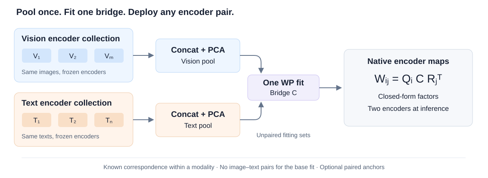

<div align="center">


### From Pairwise to Collective: Encoder Collections Make Unpaired Vision-Language Alignment Reliable

**Xuanhua Yin · Shunqi Mao · Chuanzhi Xu · Boyu Wei · Wei Guo · Weidong Cai**  
School of Computer Science, The University of Sydney  
Sydney, NSW 2006, Australia  
Contact: [xuanhua.yin@sydney.edu.au](mailto:xuanhua.yin@sydney.edu.au)

[Project page](https://xuanhuayin.github.io/ConsensusAlign/) · [Paper](https://xuanhuayin.github.io/ConsensusAlign/assets/ConsensusAlign.pdf) · [Quick Start](#quick-start) · [Reproduce](#reproduce-the-paper-protocol) · [Method](docs/method.md) · [Data](docs/data.md) · [API](docs/api.md) · [Citation](#citation)



</div>

ConsensusAlign turns shared inputs within each modality into a resource for
unpaired alignment. It pools frozen image encoders and text encoders separately,
fits one Wasserstein Procrustes bridge, and distributes that bridge through
closed-form native factors. A deployed interface uses only its two encoders
and one matrix.

This repository contains the final construction, its current extensions,
reproduction tooling, and self-contained tests. Alignment starts from stored
encoder features. The public base feature release is linked below.

## Quick Start

**Linux · Python 3.11+ · CPU fitting.** The pinned environment is tested on
Python 3.14.2. For full COCO PCA, use a machine with at least 32 GB RAM.

From the repository root:

```bash
python -m venv .venv
source .venv/bin/activate
python -m pip install torch==2.10.0 --index-url https://download.pytorch.org/whl/cpu
python -m pip install -e ".[data]"
python examples/smoke.py --output smoke_output
```

The smoke example generates small synthetic features and exercises the actual
method, including anchors, weighting, attachment, adaptation, and the optional
diagnostic. It needs no dataset download. Its metrics are software checks.

## Reproduce the Paper Protocol

The base setup uses seven vision configurations and three text encoders. Every
vision encoder sees the same image rows, and every text encoder the same caption
rows. A seeded split makes the fitting image and caption halves disjoint.

**1. Prepare the frozen features.** Download the exact files listed by the two
manifests from the public feature dataset, pinned to a fixed revision:

```bash
consensusalign-data download \
  --manifest configs/coco_train.json configs/coco_val.json \
  --revision b39767e18cdb5031020a0e1c4b8d9fba6ae13453
consensusalign-data check --manifest configs/coco_train.json
```

Add `--dry-run` to preview the file list. Data and model licenses remain those
of their original providers. See [feature preparation](docs/data.md).

**2. Inspect the run plan.** This does not load data or fit a bridge:

```bash
consensusalign-reproduce --plan configs/reproduce_coco.json --dry-run
```

**3. Run all five seeds.** Repeating the same command verifies completed artifacts
and resumes fitted runs. A changed input or protocol requires a new output path
or explicit `--overwrite`:

```bash
consensusalign-reproduce --plan configs/reproduce_coco.json --output outputs/coco
```

The result is `outputs/coco/summary.json`. It averages encoder pairs within each
seed, then computes the mean and sample SD of the seed means. Per-pair scores,
failure counts, input hashes, parameters and artifact hashes remain available.

The few-pair plan evaluates DINOv2-B/Qwen3-generative at ten positive budgets on
three seeds. It requires 30 bridge fits:

```bash
consensusalign-reproduce --plan configs/reproduce_few_pair.json \
  --output outputs/few_pair
```

Full [reproduction instructions](docs/reproduction.md) cover runtime scope,
partial-run recovery, summary validation, and evaluation beyond alignment.

## Paper Reference Results

These are the accompanying manuscript's results, not outputs of the synthetic
smoke example. Machine-readable reference values are in
[`benchmarks/reference/coco_base.json`](benchmarks/reference/coco_base.json).

| Method | COCO FOSCTTM ↓ | Failed cells ↓ | AVG10 ↑ | Flickr30k I→T R@1 ↑ |
|---|---:|---:|---:|---:|
| Pairwise WP | 0.1457 ± 0.0151 | 68 / 105 | 10.9% | 6.2% |
| **ConsensusAlign** | **0.0099 ± 0.0040** | **0 / 105** | **19.6%** | **22.0%** |

Alignment covers 21 encoder pairs over five seeds. A cell fails at FOSCTTM
> 0.05. Downstream columns use the fixed 12-pair subset over five seeds.
AVG10 averages ten classification datasets. Flickr30k uses 1,000 images and
five captions per image. See [evaluation protocols](docs/reproduction.md#evaluation-protocols).

## What You Can Run

| Capability | Entry point |
|---|---|
| Uniform or agreement-weighted pooling | `consensusalign fit --weighting uniform` or `agreement` |
| A shared budget of paired anchors | `consensusalign fit --anchors K` |
| New encoder attachment with a fixed bridge | `consensusalign attach` |
| New corpus calibration in source coordinates | `consensusalign adapt` |
| A compact two-encoder interface | `consensusalign export` |
| Alignment, classification, bidirectional retrieval | `consensusalign evaluate` |
| Independent reference fitting and agreement | `consensusalign references` and `diagnose` |

Examples and feature contracts are in the [API guide](docs/api.md). The optional
diagnostic incurs additional reference fits and produces a corpus-dependent
agreement score. Alignment itself requires one pooled bridge.

## Repository

```text
src/consensusalign/       final method, input, scoring and CLI
  _wp/                   required upstream WP numerical solver
configs/                 fixed manifests and reproducible plans
docs/                    project website and scientific documentation
benchmarks/reference/    paper reference summaries
examples/                small end-to-end example
tests/                   mathematical, data-flow and integration checks
.github/workflows/       Linux CI and wheel validation
```

## Development

```bash
python -m pip install -e ".[data,dev]"
make lint
make test
make smoke
make build
```

Tests use synthetic inputs and fixed numerical checks. CI is configured for
Python 3.11 and 3.14 and exercises an installed wheel outside the checkout.
Full COCO experiments are explicit commands and do not run in CI.
See [CONTRIBUTING.md](CONTRIBUTING.md).

## Citation

```bibtex
@unpublished{yin2026consensusalign,
  title  = {From Pairwise to Collective: Encoder Collections Make Unpaired Vision-Language Alignment Reliable},
  author = {Yin, Xuanhua and Mao, Shunqi and Xu, Chuanzhi and Wei, Boyu
            and Guo, Wei and Cai, Weidong},
  year   = {2026},
  url    = {https://xuanhuayin.github.io/ConsensusAlign/}
}
```

Structured software and manuscript citation metadata is in [CITATION.cff](CITATION.cff).

## License and Acknowledgments

Original code is released under the [MIT License](LICENSE). The numerical WP
solver is adapted from the public [unpaired-rosetta implementation](https://github.com/dominik-schnaus/unpaired-rosetta).
Its license and attribution are preserved. The public base feature files are
provided by that project's [feature collection](https://huggingface.co/datasets/schnaus/unpaired-rosetta-embeddings).
See [THIRD_PARTY.md](THIRD_PARTY.md) for dependency and data licenses.
